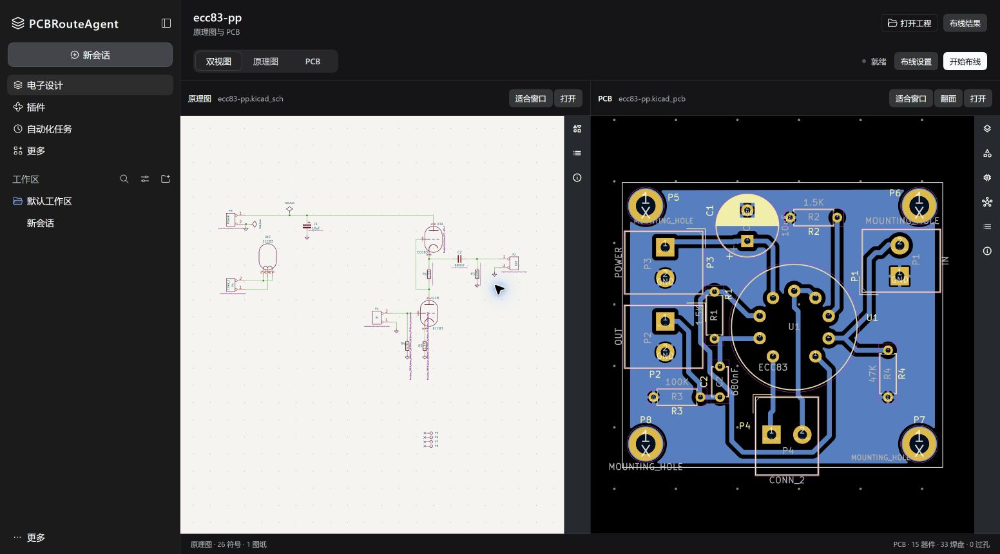

# DSH PCB agent

[简体中文](README.md)

An independent DeepSeek Harness plugin for viewing KiCad schematics and PCBs side by side, with local routing through separately installed KiCad and Freerouting tools.



It opens matching `.kicad_sch` and `.kicad_pcb` files from a `.kicad_pro`, offers individual document views, and uses local KiCanvas Canvas2D/WebGL2 rendering. Controls, themes, dialogs and session integration follow DSH. It preserves the host's branding and chat UI.

## Install

Requires Node.js 24.9+, DSH **0.2.2-rc.1**, and Python 3.12+. Inspection uses Python's standard library. Routing additionally requires KiCad with `pcbnew` Python and a Freerouting native CLI. Tested external versions: KiCad 10.0.7 and Freerouting 2.5.0 on Windows.

```sh
dsh plugin --profile web add github:NiuVector/dsh-pcbagent#v0.1.0
```

Alternatively install the prebuilt release tarball with `dsh plugin --profile web add ./dsh-pcbagent-0.1.0.tgz`. Checked-in `lib/` requires no prepare or install-time build scripts. No external engine is downloaded automatically.

On Windows, run the downloaded source's launcher:

```powershell
.\scripts\Start.ps1 -Workspace 'D:\PCB\project' -Python 'C:\Python312\python.exe'
```

Add `-KiCadRoot` and `-Freerouting` paths to enable routing. Select a DSH workspace/session, then open **Electronic design** in the sidebar. Files and results must stay within the allowed directory.

For manual launch, set `PCBROUTE_ALLOWED_ROOTS` to a JSON array of absolute directories and optionally `PCBROUTE_PYTHON`. Routing also needs `PCBROUTE_ROUTER=freerouting`, `PCBROUTE_FREEROUTING_EXE`, `PCBROUTE_KICAD_PYTHON` and `KICAD_CLI`. Run `dsh web`. Other platforms are not yet verified end to end; the adapter does not accept a Java JAR as the executable.

## Boundaries

Rendering is read-only. This release excludes PCBWorld native engines and paid model replanning. PCB data stays in the local host/browser renderer, whose iframe cannot connect to the network. DSH's chat provider remains independently configured. The plugin does not replace the editor, permissions or agent loop.

Routing writes a new output directory and runs real KiCad CLI DRC, retaining errors, warnings, unconnected items and artifact hashes. It does not perform schematic parity checks or reproduce PCBWorld benchmark scores. Review rules and final DRC before manufacturing; Specctra cannot represent every KiCad constraint.

See [development](docs/development.md), [validation](docs/validation.md) and [third-party notices](THIRD_PARTY_NOTICES.md). The plugin is an independent integration. MIT and BSD-3-Clause code and the bundled renderer/font notices are retained in `licenses/`; external KiCad and GPLv3 Freerouting executables are not redistributed.
