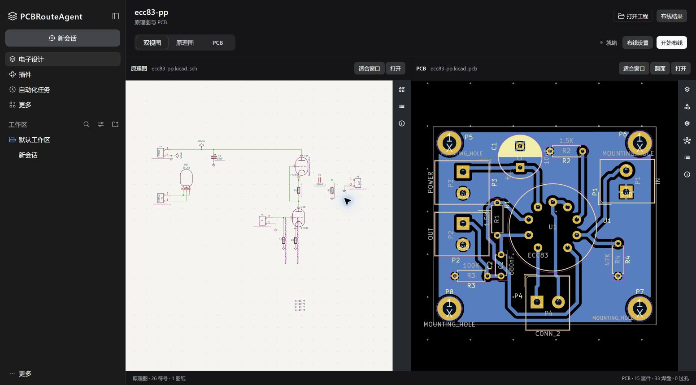

# DSH PCB agent

[English](README.en.md) · 一个独立的 DeepSeek Harness 电子设计插件。

在 DSH 中同时查看 KiCad 原理图和 PCB，并通过外部 KiCad、Freerouting 工具进行本地自动布线。



## 功能

- 原理图和 PCB 并排显示；窄窗口自动上下排列，也可切换单视图。
- 打开 `.kicad_pro` 自动配对同目录同名 `.kicad_sch` 和 `.kicad_pcb`，也可分别打开。
- 使用本地 KiCanvas：原理图 Canvas2D、PCB WebGL2，支持缩放、图层、对象与网络查看。
- DSH 标准控件、主题、工程选择、布线设置及结果窗口，不改动宿主品牌和聊天界面。
- 独立的 Host、Client 和 Typert Remote；通过正式 bundle 安装，无需修改 DSH 源码。
- 模型无关的 Freerouting 布线、KiCad DSN/SES 转换、实际 KiCad CLI DRC，原始板文件保留。

当前渲染是只读查看，不能代替 KiCad 编辑器。这个发行版不包含 PCBWorld 原生引擎或付费模型重规划。

## 安装

需要 Node.js 24.9+、**DSH 0.2.2-rc.1** 和 Python 3.12+。此版本仅对这个 DSH 版本声明兼容；Python 查看功能只需标准库。布线还需要自行安装 KiCad（测试版本 10.0.7，包含 `pcbnew` 的 Python）和 Freerouting 原生 CLI（测试版本 2.5.0）。

在已安装 DSH 的电脑上运行：

```sh
dsh plugin --profile web add github:NiuVector/dsh-pcbagent#v0.1.0
```

仓库提交了预构建的 `lib/`，没有 `prepare`、`postinstall` 或自动下载引擎的安装脚本。也可从 GitHub Releases 下载 `dsh-pcbagent-0.1.0.tgz`，再运行：

```sh
dsh plugin --profile web add ./dsh-pcbagent-0.1.0.tgz
```

### Windows 启动

下载源码后，在 PowerShell 中运行：

```powershell
.\scripts\Start.ps1 -Workspace 'D:\PCB\my-project' -Python 'C:\Python312\python.exe'
```

默认使用 `web` 配置。打开 DSH 后选择一个已有会话或工作区，再进入侧栏「电子设计」→「打开工程」。允许目录里需有 KiCad 工程文件；输出也必须在允许目录内。

要启用布线，额外指定工具路径：

```powershell
.\scripts\Start.ps1 -Workspace 'D:\PCB\my-project' `
  -Python 'C:\Python312\python.exe' `
  -KiCadRoot 'C:\Program Files\KiCad\10.0' `
  -Freerouting 'D:\Tools\freerouting-cli.exe'
```

本插件不附带上述第三方程序，也不自动安装或修改系统设置。

### 其他平台与手动配置

启动 DSH 前设置 `PCBROUTE_ALLOWED_ROOTS` 为绝对目录的 JSON 数组，以及可选的 `PCBROUTE_PYTHON`。布线额外设置 `PCBROUTE_ROUTER=freerouting`、`PCBROUTE_FREEROUTING_EXE`、`PCBROUTE_KICAD_PYTHON`、`KICAD_CLI` 为可信的可执行文件路径。然后运行 `dsh web`。

Windows 路径、停止进程树和原生工具组合已实测；其他平台未完成本插件的端到端验收。Freerouting 的 Java JAR 不是此适配器接受的原生可执行程序。

也可在 profile 的 `cordis.patch.yml` 覆盖 `pcbagent` 行，配置 `allowedRoots`、`pythonExecutable` 和可选的外部 `pcbRoot`。空的 `allowedRoots` 不开放任何文件目录。

## 数据与结果

查看器不向 KiCanvas 网站上传板文件；原始 KiCad 文本经允许目录检查后发送到本机浏览器，在禁止联网的隔离 iframe 内渲染。模型工具不会返回完整原理图或 PCB 原始源码。此发行版的布线不发起模型请求；DSH 自己的聊天提供商配置仍独立生效。

每次布线创建新的结果目录，保存板文件、DRC JSON、转换日志和带哈希的报告。界面区分错误、警告和未连接项。合格状态来自实际 KiCad DRC，不是 PCBWorld 基准得分；不做原理图一致性检查。Specctra 不能表达全部 KiCad 规则，生产前仍需人工检查原始约束和最终 DRC。

本机 Host 拥有者控制文件和任务。LiveShare 的默认拒绝策略不授予远端观看者这些接口。允许目录限制仅针对插件，不改变 DSH 其他工具的权限。

## 开发与许可证

[开发与重建](docs/development.md) · [验证范围](docs/validation.md) · [更新记录](CHANGELOG.md) · [第三方说明](THIRD_PARTY_NOTICES.md)

本项目是独立集成，不是 DeepSeek、KiCad、KiCanvas 或 Freerouting 的官方产品。插件和 DSH 派生界面使用 MIT；PCBRouteAgent 后端部分使用 BSD-3-Clause；KiCanvas、描边字体及 Material Symbols 的许可证均在 `licenses/`。KiCad 与 GPLv3 Freerouting 作为独立外部工具使用，不随本包分发。
